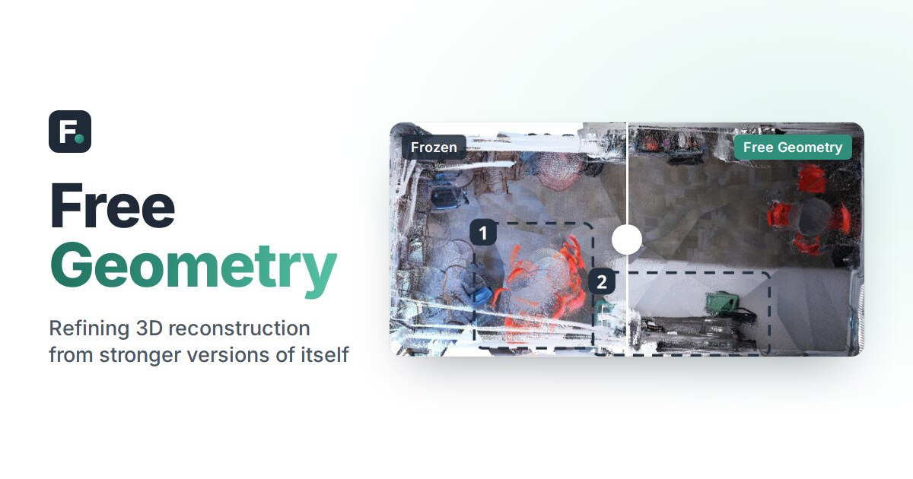

  

<h1 align="center">Free Geometry</h1>

<b>Refining 3D Reconstruction from Stronger Versions of Itself</b>

Yuhang Dai · Xingyi Yang <a href="https://lglabpolyu.github.io/">Learning &amp; Generation Lab</a>, The Hong Kong Polytechnic University

  <a href="https://free-geometry.github.io/"><b>Project page</b></a> ·
  <a href="https://arxiv.org/abs/2604.14048">arXiv</a> ·
  <a href="https://github.com/yuhangdai427/Free-Geometry">Code</a> ·
  <a href="https://free-geometry.github.io/#video">Video</a>

  

This repository hosts the project page. The site is static (HTML, CSS and JS, no build step). Every number on it is read from the paper's tables, and the point maps and error maps are exported from the real predictions.

- **3D comparison:** frozen model vs. Free Geometry for VGGT, DA3-G, VGGT-Ω, π³ and DVLT, split in one view.
- **Scene studio:** for one scene, frozen, teacher, Free Geometry and ground truth, with their cameras, all frames and a pixel probe.
- **Results:** the paper's tables, the results for every scene, the ablations.

**Credits.** Page layout adapted from [Nerfies](https://github.com/nerfies/nerfies.github.io) and [SelfEvo](https://self-evo.github.io). The music in the video is "Impact Allegretto" by Kevin MacLeod (incompetech.com), licensed under Creative Commons: By Attribution 4.0 License (https://creativecommons.org/licenses/by/4.0/).
